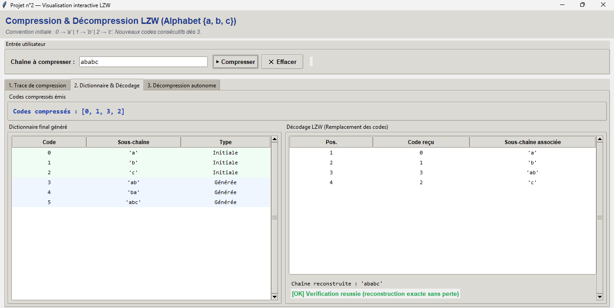
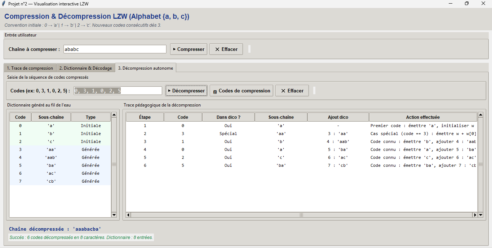

# Projet n°2 — Compression & Décompression LZW (Lempel-Ziv-Welch)

Projet universitaire d'algorithmique implémentant l'algorithme de compression et de décompression sans perte **LZW (Lempel-Ziv-Welch)** pour un alphabet restreint `{'a', 'b', 'c'}`.

Le projet est écrit en **Python 3 pur** (bibliothèque standard uniquement, sans dépendance externe), avec une architecture modulaire, une interface graphique interactive **Tkinter** et une suite de tests unitaires automatisée (`unittest`).

---

## 1. Explications théoriques

### 1.1 Qu'est-ce que la compression LZW et quel est son objectif ?
La compression **LZW** (mise au point par Terry Welch en 1984 à partir des travaux de Jacob Ziv et Abraham Lempel de 1978) est un algorithme de compression **adaptatif basé sur un dictionnaire**.
Son objectif est de réduire la redondance d'un texte ou d'un flux de données en remplaçant des répétitions de sous-chaînes de caractères par des codes numériques plus courts ou plus compacts.

### 1.2 Pourquoi un dictionnaire et comment évolue-t-il ?
Contrairement au codage de Huffman qui nécessite d'analyser d'abord les fréquences de tous les symboles d'un fichier, le LZW construit son dictionnaire **dynamiquement en un seul passage (au fil de l'eau)** :
1. **Initialisation** : Le dictionnaire commence avec les symboles de base de l'alphabet.
2. **Construction** : Dès qu'une nouvelle combinaison de caractères non présente dans le dictionnaire est rencontrée (`wk`), le code du plus long préfixe connu (`w`) est émis vers la sortie, et la nouvelle séquence `wk` est enregistrée dans le dictionnaire avec le prochain entier disponible.
3. Plus le texte contient de motifs répétitifs, plus les sous-chaînes enregistrées dans le dictionnaire deviennent longues, permettant à un seul code numérique de représenter une longue séquence de caractères.

### 1.3 Convention du dictionnaire
L'alphabet autorisé est strictement limité à `{'a', 'b', 'c'}`.
La convention d'indexation initiale est :
| Code | Sous-chaîne | Type |
| :---: | :---: | :---: |
| 0 | `a` | Initiale |
| 1 | `b` | Initiale |
| 2 | `c` | Initiale |

Les nouveaux motifs identifiés au cours de la compression reçoivent successivement les entiers 3, 4, 5, etc.

### 1.4 Décompression autonome et cas spécial
L'un des atouts fondamentaux de LZW est que **le dictionnaire n'a pas besoin d'être transmis avec les données compressées**. Le décodeur reconstruit exactement le même dictionnaire en lisant la séquence de codes.

- **Principe général** : À chaque code reçu, le décodeur retrouve la sous-chaîne correspondante, l'émet, et insère dans son dictionnaire la chaîne précédente concaténée au premier caractère de la chaîne actuelle.
- **Le Cas Spécial (`cScSc`)** : Il existe un cas particulier où l'encodeur émet un code qui vient tout juste d'être créé et qui n'a pas encore été enregistré par le décodeur (`code == prochain_code`). Cela se produit lorsqu'une sous-chaîne commence et se termine par le même caractère (ex: `aaa`, `aaaaaa`, `abababab`).
  Dans ce cas, la nouvelle sous-chaîne est obligatoirement égale à `w + w[0]`, où `w` est la sous-chaîne précédente. Notre décodeur gère rigoureusement ce cas spécial.
- **Codes invalides** : Si un code reçu n'est ni dans le dictionnaire existant, ni égal au prochain code libre, une exception `ValueError` explicite est levée.

### 1.5 Compression sans perte (Lossless)
LZW est un algorithme de compression **sans perte** : aucune information n'est détruite. L'exactitude de la reconstruction est primordiale (en informatique textuelle ou logicielle, un seul caractère corrompu rendrait le fichier inutilisable). Le programme vérifie automatiquement à la fin que `chaine_reconstruite == chaine_origine`.

### 1.6 Note sur la taille réelle de stockage
Ce projet illustre le **principe algorithmique** de LZW. Les codes sont affichés et manipulés sous forme d'entiers Python.
Dans un compresseur de production réel (comme `compress` sous Unix ou le format `GIF`), ces entiers sont stockés sous forme binaire de longueur variable (ex: 9 à 12 bits par code). Stocker naïvement les entiers sous forme de texte décimal n'optimise pas l'espace mémoire sur de très courts exemples, mais le mécanisme de substitution et l'algorithme sous-jacent sont rigoureusement identiques.

---

## 2. Structure du projet

```text
projet-multimedia-1/
├── assets/
│   ├── gui_dictionnaire_decodage.png    # Capture écran : Synthèse & Dictionnaire
│   └── gui_decompression_autonome.png   # Capture écran : Décompression autonome
├── lzw.py                               # Algorithme de compression LZW & vérification CLI
├── decompression_lzw.py                 # Algorithme de décompression LZW & dictionnaire CLI
├── interface.py                         # Interface graphique interactive (Tkinter)
├── test_lzw.py                          # Tests unitaires pour la compression
├── test_decompression.py                # Tests unitaires pour la décompression
└── README.md                            # Documentation complète et rapport d'exécution
```

---

## 3. Interface graphique (Tkinter) & Captures d'écran

L'application dispose d'une interface graphique complète développée en **Python 3 / Tkinter** (`interface.py`), structurée en trois panneaux interactifs :

### 3.1 Onglet 2 : Synthèse, Dictionnaire final & Décodage

Cet onglet permet de visualiser le résultat d'une compression (ici avec la chaîne `ababc`) :
- **Codes compressés émis** : `[0, 1, 3, 2]`
- **Dictionnaire final généré** : trié par code croissant, avec surlignage coloré distinguant les entrées *Initiales* (vert pâle) des entrées *Générées* (bleu pâle).
- **Décodage LZW** : tableau de remplacement pas-à-pas des codes par leurs sous-chaînes et indicateur de vérification sans perte.



---

### 3.2 Onglet 3 : Décompression autonome de codes & Reconstitution du dictionnaire

Cet onglet résout le problème de décompression directe à partir d'une séquence de codes numériques (ici avec la séquence `0, 3, 1, 0, 2, 5`) :
- **Saisie directe ou import** : champ de saisie acceptant divers formats (`0, 3, 1, 0, 2, 5` ou `[0, 3, 1, 0, 2, 5]`), avec bouton pour récupérer les codes d'une compression préalable.
- **Dictionnaire reconstruit au fil de l'eau** : affichage du dictionnaire régénéré de façon autonome par le décodeur sans nécessiter la transmission du dictionnaire.
- **Trace pédagogique de décompression** : étape par étape, montrant le code lu, la sous-chaîne émise, l'ajout dans le dictionnaire, et la détection du **cas spécial $cScSc$** (visible à l'étape 2 sur le code 3).
- **Chaîne décompressée** : reconstruction exacte de la chaîne originale (`'aaabacba'`).



---

## 4. Commandes d'exécution en ligne de commande (CLI)

### 4.1 Lancer l'interface graphique (Tkinter)
```bash
python interface.py
```

### 4.2 Compression LZW en ligne de commande (`lzw.py`)
- **Mode interactif** :
  ```bash
  python lzw.py
  ```
- **Avec argument direct** :
  ```bash
  python lzw.py ababc
  ```

### 4.3 Décompression LZW en ligne de commande (`decompression_lzw.py`)
- **Mode interactif** :
  ```bash
  python decompression_lzw.py
  ```
- **Avec séquence de codes en argument** (formats acceptés : liste avec crochets, virgules ou espaces) :
  ```bash
  python decompression_lzw.py "[0, 3, 1, 0, 2, 5]"
  # ou
  python decompression_lzw.py 0, 3, 1, 0, 2, 5
  # ou
  python decompression_lzw.py 0 3 1 0 2 5
  ```

### 4.4 Lancer l'ensemble des tests unitaires
```bash
python -m unittest discover
```
Ou individuellement :
```bash
python -m unittest test_lzw.py
python -m unittest test_decompression.py
```

---

## 5. Exemples de déroulement réel en console

### 5.1 Exemple de compression avec `ababc`

Commande : `python lzw.py ababc`

```text
=================================================================
       Projet n°2 — Compression LZW (Lempel-Ziv-Welch)
=================================================================
Alphabet autorisé : {'a', 'b', 'c'}
Dictionnaire initial : 0 -> 'a', 1 -> 'b', 2 -> 'c'
Les nouveaux codes sont attribués successivement à partir de 3.
=================================================================

Chaîne fournie en ligne de commande : 'ababc'

===============================================================================================
TRACE PÉDAGOGIQUE DE LA COMPRESSION
===============================================================================================
Car. k   | w        | wk       | Dans dico ?  | Code émis  | Ajout dictionnaire   | Action
-----------------------------------------------------------------------------------------------
a        | ''       | 'a'      | Oui          | -          | -                    | w devient 'a'
b        | 'a'      | 'ab'     | Non          | 0          | 3 : 'ab'             | Émettre 0, ajouter 'ab' -> 3, w devient 'b'
a        | 'b'      | 'ba'     | Non          | 1          | 4 : 'ba'             | Émettre 1, ajouter 'ba' -> 4, w devient 'a'
b        | 'a'      | 'ab'     | Oui          | -          | -                    | w devient 'ab'
c        | 'ab'     | 'abc'    | Non          | 3          | 5 : 'abc'            | Émettre 3, ajouter 'abc' -> 5, w devient 'c'
(fin)    | 'c'      | -        | Oui          | 2          | -                    | Fin de chaîne : émettre le code de w ('c')
-----------------------------------------------------------------------------------------------

Codes compressés : [0, 1, 3, 2]

=======================================================
DICTIONNAIRE FINAL
=======================================================
Code     | Sous-chaîne     | Type
-------------------------------------------------------
0        | 'a'             | Initiale
1        | 'b'             | Initiale
2        | 'c'             | Initiale
3        | 'ab'            | Générée
4        | 'ba'            | Générée
5        | 'abc'           | Générée
-------------------------------------------------------

=======================================================
CORRESPONDANCE CODES -> SOUS-CHAÎNES DÉCODÉES
=======================================================
Position   | Code     | Sous-chaîne correspondante
-------------------------------------------------------
1          | 0        | 'a'
2          | 1        | 'b'
3          | 3        | 'ab'
4          | 2        | 'c'
-------------------------------------------------------

=======================================================
RÉSULTAT DE LA VÉRIFICATION
=======================================================
Chaîne d'origine    : 'ababc'
Chaîne reconstruite : 'ababc'
Vérification : SUCCÈS (La chaîne reconstruite est rigoureusement identique à l'entrée).
=======================================================
```

---

### 5.2 Exemple de décompression avec `[0, 3, 1, 0, 2, 5]`

Commande : `python decompression_lzw.py "[0, 3, 1, 0, 2, 5]"`

```text
======================================================================
       Projet — Décompression LZW (Lempel-Ziv-Welch)
======================================================================
Alphabet autorisé : {'a', 'b', 'c'}
Dictionnaire initial : 0 -> 'a', 1 -> 'b', 2 -> 'c'
Nouveaux codes générés successivement à partir de 3.
Formats de saisie acceptés : [0, 3, 1, 0, 2, 5] ou 0, 3, 1, 0, 2, 5 ou 0 3 1 0 2 5
======================================================================

Codes reçus en argument : [0, 3, 1, 0, 2, 5]

==============================================================================================================
TRACE PÉDAGOGIQUE DE LA DÉCOMPRESSION LZW
==============================================================================================================
Étape  | Code   | Dans dico ?    | Sous-chaîne   | Ajout dictionnaire   | Chaîne cumulée       | Action
--------------------------------------------------------------------------------------------------------------
1      | 0      | Oui            | 'a'           | -                    | 'a'                  | Premier code : émettre 'a', initialiser w = 'a'
2      | 3      | Non (Spécial)  | 'aa'          | 3 : 'aa'             | 'aaa'                | Cas spécial (code == 3) : émettre w + w[0] = 'aa', ajouter 3 : 'aa', w devient 'aa'
3      | 1      | Oui            | 'b'           | 4 : 'aab'            | 'aaab'               | Code connu : émettre 'b', ajouter 4 : 'aab', w devient 'b'
4      | 0      | Oui            | 'a'           | 5 : 'ba'             | 'aaaba'              | Code connu : émettre 'a', ajouter 5 : 'ba', w devient 'a'
5      | 2      | Oui            | 'c'           | 6 : 'ac'             | 'aaabac'             | Code connu : émettre 'c', ajouter 6 : 'ac', w devient 'c'
6      | 5      | Oui            | 'ba'          | 7 : 'cb'             | 'aaabacba'           | Code connu : émettre 'ba', ajouter 7 : 'cb', w devient 'ba'
--------------------------------------------------------------------------------------------------------------

============================================================
CORRESPONDANCE CODES -> SOUS-CHAÎNES DÉCODÉES
============================================================
Position   | Code     | Sous-chaîne correspondante
------------------------------------------------------------
1          | 0        | 'a'
2          | 3        | 'aa'
3          | 1        | 'b'
4          | 0        | 'a'
5          | 2        | 'c'
6          | 5        | 'ba'
------------------------------------------------------------

============================================================
DICTIONNAIRE RECONSTRUIT (GÉNÉRÉ LORS DE LA DÉCOMPRESSION)
============================================================
Code     | Sous-chaîne        | Type
------------------------------------------------------------
0        | 'a'                | Initiale
1        | 'b'                | Initiale
2        | 'c'                | Initiale
3        | 'aa'               | Générée (Reconstruite)
4        | 'aab'              | Générée (Reconstruite)
5        | 'ba'               | Générée (Reconstruite)
6        | 'ac'               | Générée (Reconstruite)
7        | 'cb'               | Générée (Reconstruite)
------------------------------------------------------------

=================================================================
RÉSULTAT FINAL DE LA DÉCOMPRESSION
=================================================================
Codes reçus en entrée     : [0, 3, 1, 0, 2, 5]
Chaîne décompressée       : 'aaabacba'
Nombre de codes traités   : 6
Longueur chaîne obtenue   : 8 caractère(s)
Taille dictionnaire final : 8 entrées (3 initiales, 5 générées)
Statut                    : SUCCÈS (Décompression intègre et conforme)
=================================================================
```

---

## 6. Validation des tests unitaires

L'ensemble des 11 tests unitaires automatisés a été exécuté avec succès (`python -m unittest discover`) :

- **Validation des entrées** : Rejet des chaînes vides et détection explicite des caractères fautifs (`abcd`, `ABC`, `ab c`, `123`).
- **Parsing des codes de décompression** : Prise en charge des formats `[0, 3, 1]`, `0, 3, 1`, `0 3 1`, `(0, 3, 1)`, et détection des formats invalides (caractères alphabétiques, nombres négatifs).
- **Chaînes obligatoires testées** : `a`, `b`, `c`, `aa`, `aaa`, `abc`, `ababc`, `abcabcabc`, `aaabccab`, `abababab`.
- **Cas spécial du décodeur ($cScSc$)** :
  - `[0, 3]` -> `aaa` (Vérifié)
  - `[0, 3, 4]` -> `aaaaaa` (Vérifié)
  - `[0, 1, 3, 5, 1]` -> `abababab` (Vérifié)
- **Rejet des codes invalides** : Levée d'exception vérifiée sur code initial inconnu (ex: `[5]`) et sur saut de code non séquentiel (ex: `[0, 7]`).
- **Intégrité du dictionnaire généré** : Vérification de la correspondance exacte entre le dictionnaire produit par l'encodeur et celui régénéré par le décodeur.
